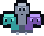
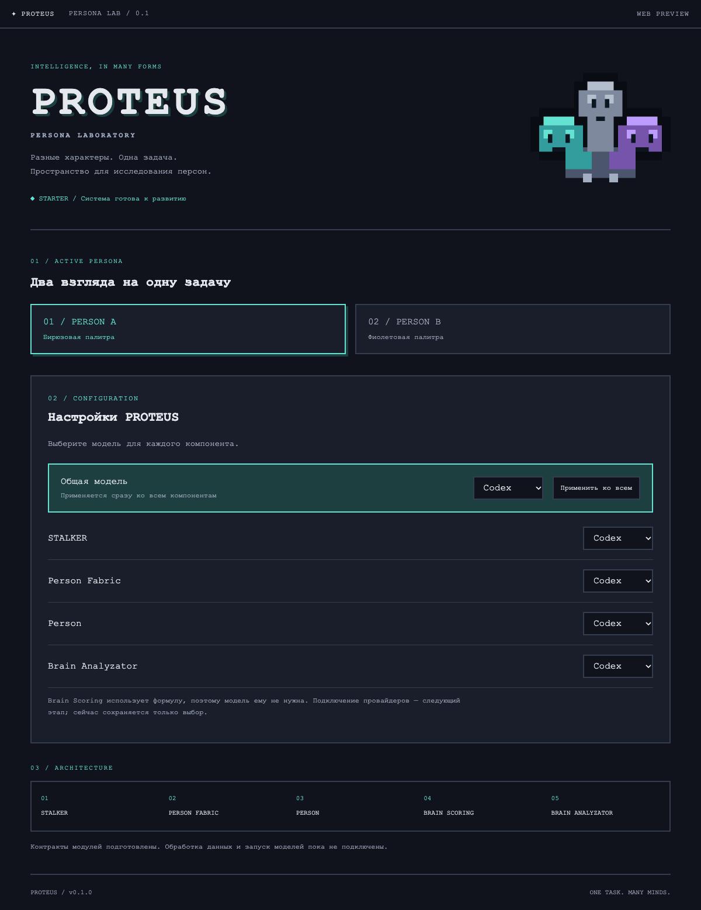

<div align="center">
  
  <h1>PROTEUS</h1>
  <p><strong>ONE TASK. MANY MINDS.</strong></p>
  <p>Лаборатория персон · бирюзовый / серый / фиолетовый</p>
  <p>SolidJS · TypeScript · Tauri · pnpm · LikeC4</p>
</div>

---

PROTEUS исследует, как разные персоны подходят к одной задаче. Этот репозиторий — стартовая основа по [архитектуре и пожеланиям из FigJam](https://www.figma.com/board/3hiDci4IiVhc7rSTiErcol/PROTEUS?node-id=2-2572): рабочая оболочка приложения, контракты модулей и проверяемые границы между ними.

**Уже работает:** настройки моделей по компонентам и общий переключатель, сохранение настроек, смена палитры по персоне, безрамочное окно с собственными controls, расчёт BSC и автоматические проверки. **Следующий этап:** реальные подключения Kimi/Codex, поиск и построение персон, выполнение задач и аналитика. Стартовый экран не отправляет запросы моделям.



## Быстрый старт

Нужны Node.js 24+ и pnpm **11.9.0**. Версия pnpm зафиксирована в `packageManager`.

```sh
corepack enable
corepack prepare pnpm@11.9.0 --activate
pnpm install --frozen-lockfile
pnpm dev
```

Откройте `http://127.0.0.1:1420`. В браузере нативные кнопки окна скрыты.

Для desktop нужны Rust (stable, rustfmt, clippy) и [системные зависимости Tauri](https://v2.tauri.app/start/prerequisites/):

```sh
pnpm desktop          # разработка в нативном окне
pnpm build:desktop    # один release-бинарник для текущей ОС
```

Результат: `apps/desktop/src-tauri/target/release/proteus` (`proteus.exe` на Windows). Frontend встроен, отдельный Node-процесс не нужен. Системный WebView и библиотеки ОС остаются необходимыми; это не универсальный бинарник для всех платформ.

## Карта проекта

```text
apps/desktop/          SolidJS + FSD + SCSS Modules
  src-tauri/           Rust shell, capabilities, embedded frontend
packages/
  contracts/           общие типы и наблюдаемые traces
  intelligence/        порты провайдеров и настройки моделей
  stalker/             публичные данные → обезличенный контекст
  person-fabric/       контекст + задача → персона
  person/              архетип + навыки → выполнение задачи
  brain-scoring/       reasoning minutes / estimated BSC
  brain-analyzator/    результаты + traces → анализ
architecture/          LikeC4, источник правил зависимостей
scripts/               селективные проверки и architecture gate
.beads/                конфигурация и snapshot задач
```

Все npm-пакеты имеют scope `@proteus-int/`. Между ними используются только публичные API и `workspace:*`. Приложение строится по FSD; слои и границы проверяются автоматически.

## Проверки

```sh
pnpm check                       # полный JS gate и production frontend build
pnpm check:package intelligence   # пакет + его зависимые пакеты
pnpm check:changed                # изменения относительно origin/trunk
pnpm test:watch                   # TDD
pnpm exec playwright install chromium
pnpm test:e2e                    # настройки и палитра в браузере
pnpm check:rust                   # rustfmt + clippy + cargo test
pnpm architecture                # интерактивная карта LikeC4
```

Husky запускает селективные проверки перед commit, commitlint проверяет Conventional Commits, полный gate выполняется перед push. GitHub Actions добавляет e2e и нативную сборку для macOS, Linux и Windows. Основная ветка — **`trunk`**.

## Работа с агентом

Начните с [AGENTS.md](AGENTS.md). Задачи ведутся в Beads (`bd`), изменения небольшие и атомарные, поведение разрабатывается через TDD. После клонирования: `pnpm beads:init`; порядок восстановления snapshot описан в harness.

- [Архитектура и границы модулей](docs/architecture.md)
- [Harness, селективные проверки и Beads](docs/harness.md)
- [Соответствие пожеланиям и следующие этапы](docs/requirements.md)

<div align="center"><sub>PROTEUS · разные характеры, общая основа</sub></div>
