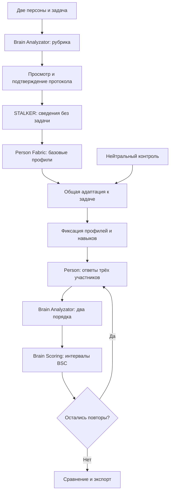
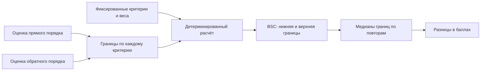
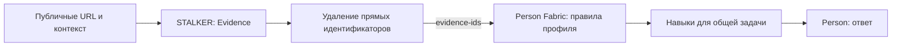
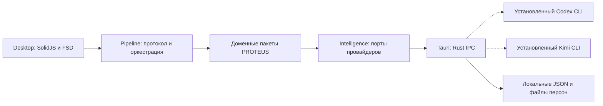

<div align="center">
  
  <h1>PROTEUS</h1>
  <p><strong>ONE TASK. MANY MINDS.</strong></p>
  <p>Лаборатория персон · бирюзовый / серый / фиолетовый</p>
  <p>SolidJS · TypeScript · Tauri · pnpm · LikeC4</p>
</div>

---

PROTEUS — настольная лаборатория, где две симулированные персоны и нейтральный контроль решают одну задачу. Приложение собирает публичные сведения или выбранные разрешённые материалы подключённых источников, формирует профили, выполняет реальные запросы через установленные **Codex / Kimi CLI** и сравнивает ответы по общей рубрике.

**В версии 0.3.0 BSC по-прежнему измеряет выполнение критериев задачи по шкале 0–100.** Оценка сохраняется интервалом, если данных недостаточно или два прохода судьи расходятся. Длительность запроса, ошибки формата, происхождение профиля и повторяемость показываются отдельно. Это эксперимент над поведением моделей с разными инструкциями; он не измеряет интеллект реальных людей и не доказывает точность их симуляции.

Основные сущности сохранены: **STALKER, Person Fabric, Person, Brain Scoring и Brain Analyzator**. Brain Analyzator теперь также готовит рубрику до исследования персон и оценивает ответы до численного расчёта Brain Scoring. Новые данные — протокол эксперимента, связи с источниками, повторные попытки и нейтральный контроль — находятся внутри существующих пакетов.

## Как проходит эксперимент

1. Введите общую задачу и две персоны: имя, контекст и до пяти публичных ссылок на каждую. Для Telegram, VK, GitHub или Instagram откройте настройки подключений, затем добавьте выбранный источник к Персоне. [Подготовка аккаунтов и приложений](docs/connections.md).
2. Подготовьте протокол: приложение создаст рубрику, покажет критерии, веса, обязательные условия и выбранные настройки. Подтвердите протокол перед исследованием персон.
3. STALKER соберёт сведения без доступа к задаче. Person Fabric создаст базовые профили, а затем отдельно адаптирует их к одной обезличенной задаче. Нейтральный контроль пройдёт ту же адаптацию.
4. Person выполнит задачу для всех трёх участников с общими настройками. Выберите один разведочный или три повторных прогона. Профили и адаптация между повторами сохраняются.
5. Brain Analyzator оценит анонимные ответы в прямом и обратном порядке. Brain Scoring детерминированно рассчитает интервалы BSC и разницы в баллах.
6. Изучите ответы, оценки по критериям, источники, ограничения и Intelligence traces. Результат можно сохранить локально и выгрузить в JSON.



В режиме трёх повторов порядок выполнения циклически меняется: `A → B → контроль`, `B → контроль → A`, `контроль → A → B`. Одновременно работает один CLI. Такая перестановка распределяет позиции между участниками, но не устраняет задержки провайдера и случайность генерации.

## Что означает BSC v2

Рубрика фиксируется до получения ответов. Каждый критерий имеет положительный вес, признак обязательности и текстовые условия для трёх уровней выполнения. Судья возвращает статус, краткое обоснование и фрагмент ответа; Brain Scoring выполняет только проверку данных и арифметику, без собственной модели.

| Статус критерия | Вклад в оценку | Значение                              |
| --------------- | -------------- | ------------------------------------- |
| `unmet`         | 0              | Требование не выполнено               |
| `partial`       | 0,5            | Выполнено частично согласно рубрике   |
| `met`           | 1              | Требование выполнено согласно рубрике |
| `unknown`       | от 0 до 1      | По доступным данным оценить нельзя    |

Для каждого критерия берутся минимальная нижняя и максимальная верхняя границы двух оценок. Общий BSC — взвешенная сумма этих границ, делённая на сумму **всех** весов и умноженная на 100. Неоценённый критерий не исчезает из знаменателя. Если судья поставил `met` и `partial`, вклад критерия составляет `[0,5; 1]`, а не усреднённые `0,75`.



В итогах отдельно сохраняются медианы границ, разброс прогонов, число запланированных и оценённых попыток, обязательные условия и разногласия судьи. Интервал здесь описывает неопределённость выставленных оценок; **это не статистический доверительный интервал**.

Сравнение с нейтральным контролем отвечает на вопрос: «Что изменилось при добавлении этого профиля в данных условиях?» Разница считается в баллах BSC, включая границы неопределённости. Отдельно показывается разница между двумя персонами. Отношение «во сколько раз умнее» не используется.

Описательное сравнение считается допустимым только для полной серии из трёх прогонов: обязательные условия выполнены, оценки каждого прогона определены и судья не расходится сам с собой. Приложение не объявляет автоматического победителя. Один прогон описывает один эксперимент. Три прогона показывают наблюдавшийся разброс, но сами по себе не устанавливают статистическую значимость или устойчивое преимущество на других задачах.

## Откуда берутся персоны

STALKER разделяет публичные свидетельства, гипотезы, неизвестное и противоречия. Связь с URL и выдержкой позволяет проверить основание, но `model-reported` означает сообщение модели об источнике, а не независимую проверку факта приложением.



Правила профиля и навыки сохраняют ссылки на исходные свидетельства и ограничения. `supported` означает заявленную моделью опору на источник; `retrieved-at` для публичного модельного поиска остаётся `null`. У нативных источников `source-retrieved` и время загрузки подтверждают происхождение текста, но не истинность содержащихся в нём утверждений. Нет оснований — нет утверждения о доказанном свойстве человека. Профиль без достаточной опоры на публичные сведения помечается как синтетический; нейтральный контроль имеет отдельный статус.

Базовый профиль строится без задачи, чтобы знание будущего испытания не превращалось в приписанный человеку навык. Адаптация к задаче выполняется отдельно и одинаковым способом для обеих персон и контроля. Все три участника получают одну обезличенную формулировку задачи и одинаковые настройки Person: провайдер, запрошенная модель и effort. Фактическая модель адаптером не подтверждается: `resolved-model` остаётся неизвестной.

Обезличивание удаляет известное имя, URL, handles и другие прямые идентификаторы из передаваемого контекста. Это не гарантия удаления всех косвенных признаков. Качество источников и соответствие симуляции реальному человеку не входят в BSC: высокое качество ответа не доказывает достоверность биографического профиля.

## Архитектура

Это одно desktop-приложение со встроенным frontend. Пакеты на схеме — логические границы, а не отдельные серверы.

Дополнительно `apps/auth` предоставляет статическую страницу возврата VK ID. Она публикуется вместе со схемами LikeC4 на GitHub Pages; [адреса и настройка VK](docs/auth.md). Нативная авторизация и получение данных VK пока не реализованы.



| Пакет              | Ответственность                                                                         |
| ------------------ | --------------------------------------------------------------------------------------- |
| `desktop`          | Ввод, просмотр протокола, прогресс, результаты, настройки, нативное окно                |
| `auth`             | Статический callback VK, очистка URL, проверка формата и возврат в приложение           |
| `pipeline`         | Фиксация протокола, подготовка участников, повторы, порядок, отмена, экспорт результата |
| `contracts`        | Общие типы профиля, свидетельств, рубрики, оценок, протокола и наблюдаемых traces       |
| `intelligence`     | Порты Codex/Kimi, настройки компонентов, проверка структурированных ответов             |
| `stalker`          | Публичные сведения, происхождение утверждений и ограничения                             |
| `person-fabric`    | Базовый профиль без задачи и отдельная адаптация к задаче                               |
| `person`           | Выполнение задачи по профилю; экспорт `AGENTS.md` и `SKILL.md`                          |
| `brain-analyzator` | Рубрика, оценка анонимных ответов, обоснования и сравнение                              |
| `brain-scoring`    | Детерминированные интервалы BSC, агрегирование и разницы                                |

Источник правил зависимостей — [`architecture/proteus.c4`](architecture/proteus.c4). Импорты между пакетами идут через публичные `@proteus-int/*` API; циклы и нарушения FSD проверяются автоматически. Подробности протокола, контрактов и нативной границы — в [описании архитектуры](docs/architecture.md).

## Быстрый старт

Нужны Node.js 24+ и pnpm **11.9.0**. Версия pnpm зафиксирована в `packageManager`.

```sh
corepack enable
corepack prepare pnpm@11.9.0 --activate
pnpm install --frozen-lockfile
pnpm dev
```

Откройте `http://127.0.0.1:1420`. В браузере доступен интерфейс; настоящие CLI запускаются только в нативном приложении. Нативные кнопки окна в браузере скрыты.

Перед первой нативной сборкой выполните `pnpm prepare:tdlib`: скрипт скачивает закреплённый архив официальной TDLib и проверяет SHA-256. Библиотека статически собирается вместе с OpenSSL; нужны CMake, gperf, C/C++ compiler и zlib (подробности в workflows).

Для desktop нужны Rust stable с rustfmt/clippy и [системные зависимости Tauri](https://v2.tauri.app/start/prerequisites/). Минимальная версия Rust указана в `apps/desktop/src-tauri/Cargo.toml`.

```sh
pnpm desktop          # разработка в нативном окне
pnpm build:desktop    # release-бинарник для текущей ОС
pnpm bundle:macos     # PROTEUS.app для macOS
```

Бинарник: `apps/desktop/src-tauri/target/release/proteus` (`proteus.exe` на Windows). Frontend встроен; отдельного Node-сервера приложения нет. Системный WebView и библиотеки ОС остаются необходимыми; это не универсальный бинарник для всех платформ.

На macOS приложение находится в `apps/desktop/src-tauri/target/release/bundle/macos/PROTEUS.app`. Перенесите его в «Программы».

## CLI и настройки

Установите и авторизуйте нужные CLI самостоятельно: `codex login`, `kimi login`. Интеграция Kimi использует режим `--prompt --output-format stream-json` Kimi Code 2.x с явным профилем агента. В проверенной версии 2.3.2 режим ACP игнорирует `--agent-file`, поэтому для экспериментов он не используется. PROTEUS не читает и не копирует файлы токенов.

В настройках выберите провайдера и при необходимости модель/alias отдельно для STALKER, Person Fabric, Person и Brain Analyzator. Общий переключатель применяет провайдера ко всем компонентам. Brain Scoring детерминирован и не имеет выбора модели. Пустой alias оставляет выбор модели настройкам CLI.

Протокол сохраняет запрошенные настройки. Trace отличает их от реально наблюдённых: текущий нативный адаптер не подтверждает разрешённое имя модели и версию CLI, поэтому `resolved-model` и `cli-version` равны `null`. Codex получает явную настройку effort; для Kimi применённое значение неизвестно. Одинаковые названия effort у разных провайдеров не означают одинаковый вычислительный бюджет.

## Traces, ошибки и ограничения

- `wall-time-ms` — длительность запроса, включая запуск CLI, ожидание провайдера и получение ответа. Точное активное время рассуждения неизвестно: `active-reasoning-ms: null`.
- Старое поле `reasoning-ms` сохранено для совместимости и содержит ту же длительность запроса. В формулу BSC v2 время не входит.
- Intelligence traces показывают только reasoning, явно опубликованный структурированным потоком CLI. Codex передаёт summaries; режим `stream-json` Kimi 2.3.2 не передаёт thinking. Для Kimi приложение явно показывает отсутствие текста reasoning; ответ и stderr его не заменяют.
- Неверный JSON или схема вызывают одну повторную попытку текущего этапа с объяснением ошибки формата. Второй вызов заново генерирует ответ этапа: сохранение его содержания не гарантируется. Это техническое исправление, а не независимый прогон эксперимента. Обе попытки и их время учитываются.
- Отмена, ошибка провайдера или повторная ошибка формата останавливают дальнейшие вызовы. Полученные traces остаются доступны в текущем окне. Если серия уже началась, её результат помечается как неполный или отменённый и сохраняет выполненные попытки; ошибки подготовки показываются до начала серии.
- Один этап ограничен 10 минутами и 4 МиБ чтения stdout. Reasoning ограничен 48 КиБ на попытку; усечение помечается явно.

Codex запускается с `exec --json`, read-only, без пользовательской конфигурации, rules, hooks, plugins и встроенных инструментов. Поддержка флагов проверяется до передачи текста. Web search доступен только явной операции публичного исследования. Kimi использует WebSearch/FetchURL только в публичном исследовании, но его пользовательские hooks пока нельзя надёжно отключить: прогон с подключёнными источниками требует Codex для всех компонентов. Временные промпты удаляются после этапа. Приложение не извлекает зашифрованное или необъявленное внутреннее состояние модели.

## Сохранение и совместимость

На macOS результаты сохраняются в `~/Library/Application Support/dev.proteus-int.desktop/experiments/`; на других ОС используется системный каталог данных приложения. JSON содержит протокол, профили, ответы, оценки и traces; нативное сохранение ограничено 8 МиБ и явно сообщает о превышении. Рядом сохраняются артефакты персон. Общий фильтр экспорта исключает запрещённые образцы речи, исходные выдержки подключённых источников и приватные traces подготовки; ограничения редактирования описаны в [архитектуре источников](docs/stalker-source-architecture.md). Эти материалы могут содержать исходный пользовательский контекст и публичные сведения: обезличивание входа Person Fabric не означает удаления исходного ввода из локального результата.

Новые результаты имеют `schema-version: 3` и `scoring-version: 2`. Исторические JSON v1 остаются историческими: старая формула `длительность в минутах / estimated-bsc` не пересчитывается в BSC v2, и значения разных версий напрямую не сравниваются. Импорт архивных результатов как нового эксперимента не предусмотрен.

**Пресеты `.proteus` остаются версии 1.** Они сохраняют пару персон и общую задачу, а не результаты, критерии, модели, ключи или traces. Формат — UTF-8 JSON с `format: "proteus-personas"` и `version: 1`, максимум 128 КиБ. Задача может быть пустой. Новый запуск заново подготавливает протокол и профили.

В установленном приложении работают системные диалоги импорта/экспорта и открытие `.proteus` из файлового менеджера. Импорт во время эксперимента откладывается до его завершения. Открытие файла само по себе не запускает модели; повреждённый файл не заменяет введённые данные. Пагинация сохраняет исходные пробелы и переносы.

## Интерфейс

Бирюзовая и фиолетовая палитры персон, серая центральная голова логотипа и пиксельные кнопки окна сохранены. Основные состояния — ввод и протокол, выполнение, результат. Длинные поля, журнал и ответы разбиты на страницы без прокрутки. Минимальное нативное окно — 640×600.

## Проверки

```sh
pnpm check                       # полный JS gate и production frontend build
pnpm check:package intelligence  # пакет и транзитивно зависимые пакеты
pnpm check:changed               # смешанное изменение относительно origin/trunk
pnpm test:watch                  # TDD
pnpm exec playwright install chromium
pnpm test:e2e                    # браузерные сценарии и отсутствие overflow
pnpm check:rust                  # rustfmt, clippy и Rust tests
pnpm build:desktop               # нативная release-сборка
pnpm architecture               # интерактивная карта LikeC4
pnpm dev:auth                   # локальная страница возврата VK
pnpm build:pages                # совместная сборка auth и LikeC4
```

Если Chrome уже установлен, браузерные сценарии можно запустить с `PLAYWRIGHT_CHANNEL=chrome pnpm test:e2e`. Полный набор обязательных проверок выполняется в CI. Наличие команды или теста в репозитории не означает, что конкретный кандидат релиза уже прошёл проверку; статус версии отражён в [release notes](docs/release-notes.md) и GitHub Actions.

## Релизы

Тег `vX.Y.Z` запускает `.github/workflows/release.yml`: проверки, затем установщики macOS Apple Silicon, macOS Intel, Windows x64 и Linux x64. Публикация выполняется после успешной сборки всех четырёх вариантов, вместе с `SHA256SUMS.txt`, через встроенный `GITHUB_TOKEN`.

Перед выпуском синхронизируйте версии в корневом и desktop `package.json`, `tauri.conf.json`, `Cargo.toml` и записи `proteus` в `Cargo.lock`. После проверок и push создайте и отправьте тег нужной версии. Workflow можно повторить через Actions → Release → Run workflow с существующим тегом; уже опубликованные файлы не заменяются. macOS использует ad-hoc подпись без notarization, Windows — сборку без сертификата издателя.

## Работа с репозиторием

```text
apps/desktop/          SolidJS, FSD, SCSS Modules
  src-tauri/           Rust, IPC, встроенный frontend
apps/auth/             статический callback VK, SolidJS/FSD
packages/              восемь общих и доменных пакетов; с двумя apps — десять @proteus-int/*
architecture/          LikeC4 и правила зависимостей
scripts/               селективные проверки и architecture gate
.beads/                конфигурация и snapshot задач
```

Основная ветка — `trunk`. Начните с [AGENTS.md](AGENTS.md); порядок TDD, атомарных Conventional Commits, hooks и работы с Beads описан в [harness](docs/harness.md). [Требования](docs/requirements.md) связывают продуктовые границы с реализацией и проверками.

<div align="center"><sub>PROTEUS · разные характеры, общая основа</sub></div>
