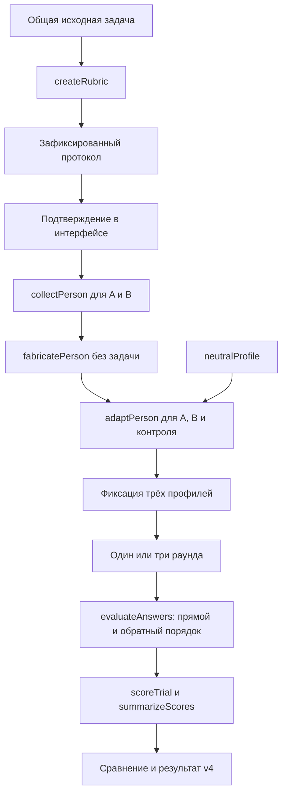
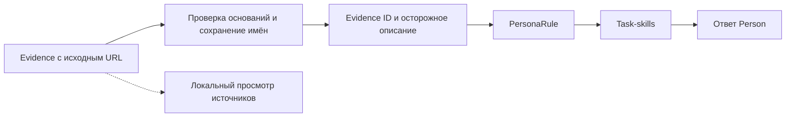

# Архитектура PROTEUS 0.3

Исходная концепция и названия сущностей происходят из [доски PROTEUS](https://www.figma.com/board/3hiDci4IiVhc7rSTiErcol/PROTEUS?node-id=0-1). Текущее правило зависимостей задаёт `architecture/proteus.c4`; его связи `imports` проверяются по manifests и TypeScript AST. IPC и запуск CLI описаны отдельно и не считаются npm-зависимостями.

Версия 0.3 сохраняет монорепозиторий, desktop-приложение, порты провайдеров и доменные пакеты, добавляя нативные источники и профиль стиля. Протокол BSC v2 сохраняется: качество ответа оценивается по заранее зафиксированным критериям; время запроса больше не выступает мерой способностей персоны.

Реализованы статический `apps/auth` и нативный приём callback VK: одноразовый state, PKCE, обмен и обновление токенов в Rust. [Адреса и протокол возврата](auth.md). TDLib, GitHub device flow, VK API, импорт файлов и собственный Instagram Business/Creator API подключаются в настройках desktop.

[Архитектура подключений и навыков STALKER](stalker-source-architecture.md) описывает четыре встроенных навыка, ограниченный SourcePort и отдельный анализ корпуса. В профиль входят связанные с образцами правила речи и оформления; границы сообщений и исходное форматирование сохраняются. В LikeC4 amber-компоненты обозначают оставшиеся расширения: браузерный сбор и независимую оценку сходства на отложенных диалогах.

## Ответственность пакетов

| Пакет              | Ответственность                                                                             | Основные данные                                                                                            |
| ------------------ | ------------------------------------------------------------------------------------------- | ---------------------------------------------------------------------------------------------------------- |
| `desktop`          | SolidJS/FSD, просмотр протокола, запуск, прогресс, результаты, настройки, Tauri IPC         | Ввод, состояние интерфейса                                                                                 |
| `auth`             | Статическая страница возврата VK, очистка URL и фиксированная ссылка приложения             | Callback v1; без обмена и хранения токенов                                                                 |
| `pipeline`         | Подготовка протокола, последовательность этапов, контроль, повторы, отмена, сбор результата | Протокол, участники, прогоны, журнал вызовов                                                               |
| `contracts`        | Общие типы и наблюдаемые данные                                                             | Evidence, PersonProfile, EvaluationRubric, TrialScore, ScoreSummary, ExperimentProtocol, IntelligenceTrace |
| `intelligence`     | Порты провайдеров, настройки компонентов, структурированный ответ и исправление формата     | IntelligenceRequest / IntelligenceResult                                                                   |
| `stalker`          | Публичные и выбранные разрешённые источники, происхождение, стиль и ограничения             | StalkerReport / Evidence                                                                                   |
| `person-fabric`    | Базовый профиль без задачи, отдельная адаптация, нейтральный профиль                        | PersonaRule / PersonProfile                                                                                |
| `person`           | Выполнение задачи согласно зафиксированному профилю, артефакты                              | Ответ, AGENTS.md, SKILL.md                                                                                 |
| `brain-analyzator` | Рубрика по задаче; оценка анонимных ответов по каждому критерию                             | EvaluationRubric / AnswerEvaluation                                                                        |
| `brain-scoring`    | Проверки числовых инвариантов, интервалы, медианы, разницы                                  | TrialScore / ScoreSummary / ScoreInterval                                                                  |

`Brain Scoring` не вызывает модель. `Brain Analyzator` оценивает соответствие ответа рубрике, но не является источником подтверждённых фактов о человеке.

Текущие владельцы модулей и сценарии проверки навыка перечислены в
[путеводителе по коду](code-owners.md). [Единый стандарт](code-style.md) применяется
к RAG, UX и native; [совместимость](code-compatibility.md) отделяет текущие writers
от исторического inventory.

Нативный SQLCipher-корпус хранит immutable revisions, snapshots и очередь импорта.
Схема 7 добавляет отдельные таблицы исследовательской памяти, замороженных
манифестов, навыков, квитанций публикации и истории симуляций. Переход со схемы 6
атомарен: конфликт откатывает все новые объекты, прежние данные и индексы
сохраняются. Удаление снимка источника каскадно удаляет его производную память;
исходные ревизии и сгенерированные реплики остаются разными пространствами данных.
Наличие таблиц ещё не означает готовность публикации памяти или выдачу разрешения
модели: проверку происхождения и текущего доступа выполняют нативные сценарии.

`corpus_database::memory_store` атомарно сохраняет исследовательский снимок и его
элементы, проверяя владельца, порядок ID, версию извлечения и принадлежность
ссылок исходному снимку. Повтор допускается только с теми же данными. Пакет
ограничен 16 MiB сериализованных данных: запись ограничивает JSON при создании,
чтение проверяет общий объём по метаданным до чтения содержимого элементов.
Отмена перед commit откатывает весь пакет. Повторное чтение сверяет хеши,
исходный снимок и ссылки противоречий; исходные ревизии не перезаписываются.
Это хранилище, а не разрешение на обработку: точный текст, авторство, reference/
holdout и использованные model-context leases проверяет сценарий публикации.

Подготовка эпизодов и reference-only FTS описаны в [local-tokenizer](local-tokenizer.md),
CPU inference — в [local-embedding](local-embedding.md). Наличие этих внутренних
адаптеров не означает завершённость MemoryPort, vector index или пользовательского
RAG-сценария: их приёмка остаётся в задачах `proteus-tip`.

## Протокол и последовательность

Протокол фиксирует общую задачу, рубрику, число повторов `1 | 3`, порядок участников, настройки компонентов, политику исправления формата, таймаут и версию промптов. Рубрика создаётся до исследования персон и решения задачи. UI показывает её пользователю перед запуском остальных этапов. Изменение задачи или условий требует нового протокола.

STALKER и создание базовых профилей выполняются один раз. Они не получают задачу; Fabric получает выбранную идентичность, исходные свидетельства, ссылки, цитаты и ограничения; пользовательский контекст остаётся непроверенным описанием. Адаптация получает ту же общую задачу для всех участников и запрашивает `medium` effort. Нейтральный контроль проходит адаптацию, чтобы сравнение не смешивало влияние профиля с наличием дополнительного этапа подготовки.

После подготовки профиль и task-skills не меняются между повторами. Повторяется выполнение Person и оценка ответов. Участники используют одинаковые запрошенные настройки Person; фактическая модель не подтверждается адаптером и хранится как `resolvedModel: null`. Их ответы не передаются друг другу.

| Раунд | Последовательность вызовов Person |
| ----- | --------------------------------- |
| 1     | A → B → нейтральный контроль      |
| 2     | B → нейтральный контроль → A      |
| 3     | Нейтральный контроль → A → B      |

Режим одного повтора использует первую строку. Без исправлений формата выполняется 13 модельных этапов для одного повтора и 23 для трёх: рубрика, два исследования, два базовых профиля, три адаптации и по пять этапов на раунд. Один CLI выполняется в каждый момент времени. Перестановка распределяет позиции в режиме трёх повторов; она не обеспечивает статистическую независимость и не выравнивает состояние внешнего провайдера.

После каждого набора из трёх ответов судья получает задачу, рубрику и тексты с временными метками `answer-1`, `answer-2`, `answer-3`. Во втором проходе порядок разворачивается и метки назначаются заново. Соответствие временных меток участникам восстанавливается в коде. Судье не передаются имена, биографии, провайдеры, BSC, длительность или reasoning исполнителей. Сам текст ответа всё ещё может содержать узнаваемый стиль; слепая оценка не гарантирует отсутствия всех смещений.

## Происхождение сведений и профиля

`Evidence` хранит непрозрачный ID, URL источника, тип `fact | hypothesis`, статус, краткое содержание, выдержку и ограничения.

| Поле или статус                | Интерпретация                                                                |
| ------------------------------ | ---------------------------------------------------------------------------- |
| `supported`                    | Модель указала публичный источник и выдержку для факта                       |
| `hypothesis`                   | Предположение; пользовательский контекст не становится подтверждённым фактом |
| `unknown`                      | Сведений недостаточно                                                        |
| `conflicting`                  | Есть противоречие                                                            |
| `verification: model-reported` | URL и выдержку сообщил провайдер; приложение не проверило их независимо      |
| `verification: unverified`     | Нет достаточного представленного основания                                   |
| `retrievedAt: null`            | Адаптер не подтверждает момент получения источника                           |

STALKER больше не выводит предполагаемый интеллект, `estimated-bsc` или персональный вычислительный effort. Структурная проверка требует уникальных ID и публичного URL для `fact`; `supported` дополнительно требует выдержку. Такая проверка доказывает соответствие формату, а не истинность утверждения.

Перед Fabric сохраняются имена, авторство, отношения между участниками, исходные summaries, URL, цитаты и ограничения свидетельств. Идентичность помогает удерживать роль, но не заменяет источники; модель не должна заполнять пробелы предположениями об известном имени. Правила `PersonaRule` ссылаются на `evidenceIds`. Ссылки обязаны существовать; `unknown` и `conflicting` не могут оправдывать поведенческое правило; гипотеза не повышается до `supported`. Несвязанные описательные поля отчёта не используются как самостоятельное доказательство.

`sourceStatus: evidence-informed` означает наличие хотя бы одного правила с модельно заявленной опорой на источник. При отсутствии таких правил профиль имеет `synthetic`; контроль — `neutral`. Это происхождение профиля, а не числовая мера достоверности.

У персонализированной task-skill сохраняется происхождение и осторожный статус правила. Общая стратегия решения может иметь пустые `evidenceIds`, но только как `hypothesis`; она не выдаётся за обнаруженный навык человека. Контроль использует такие общие стратегии без персональных черт. Ограничения исходных свидетельств наследуются правилами и навыками.

Общая задача передаётся всем участникам без подмены имён, URL или handles. Person получает personaLabel и инструкции отвечать от первого лица выбранного человека с опорой на профиль; нейтральный контроль получает null и не принимает личную роль. Версия промптов новых запусков — `bsc-v2.4-camel-case`; прежние `bsc-v2.3-source-identity` и `bsc-v2.2-source-style` сохраняются в исторических результатах. Оценщик по-прежнему получает answer-1/answer-2 как метки порядка, но содержимое ответов не обезличивается; это не гарантия сокрытия идентичности.

## BSC v2 и интерпретация

`createRubric` принимает только задачу и возвращает рубрику версии 2 с 1–12 критериями. Каждый критерий содержит уникальный ID, положительный конечный вес, обязательность и текстовые anchors для `unmet`, `partial`, `met`. Рубрика фиксируется до ответов; её содержание остаётся модельным предложением, которое пользователь просматривает до эксперимента.

`evaluateAnswers` требует оценить каждого участника по каждому критерию ровно один раз. Ответ судьи включает статус, обоснование и цитату. Для `met` и `partial` цитата обязательна и должна буквально присутствовать в оцениваемом ответе. Цитата подтверждает, что судья ссылается на существующий фрагмент; она не доказывает верность его интерпретации или фактов внутри фрагмента. Отсутствующее требуемое содержание — `unmet`; невозможность проверить утверждение — `unknown`.

Детерминированный расчёт `scoreTrial`:

1. Преобразует `unmet`, `partial`, `met` в `[0; 0]`, `[0,5; 0,5]`, `[1; 1]`; `unknown` — в `[0; 1]`.
2. Объединяет два прохода по каждому критерию: минимум нижних и максимум верхних границ. Различие статусов помечается как `disputed`.
3. Взвешивает каждую границу и делит на сумму всех весов, включая неизвестные критерии; масштабирует результат до 0–100.
4. Проверяет обязательные критерии: нижняя граница 1 означает `passed`, верхняя меньше 1 — `failed`, остальные случаи — `unknown`.

`RequiredStatus` общего результата равен `failed`, если есть провал; иначе `unknown`, если есть неизвестное; иначе `passed`. Высокие баллы необязательных критериев не отменяют провал обязательного условия.

`summarizeScores` хранит медианы нижних и верхних границ, крайние значения по прогонам, оценённое и запланированное число попыток, состояние обязательных критериев и разногласия. Точечное значение появляется только у полного набора оценок, когда итоговые границы совпадают. Частичный результат не получает признак допустимости сравнения.

Признак `comparisonEligible` требует полного набора оценок, прохождения обязательных условий, точечных интервалов всех прогонов и отсутствия разногласий судьи. Совпавшая медиана не скрывает неопределённый отдельный прогон. Pipeline дополнительно требует три повтора и допустимость сравнения всех участников, включая контроль. Приложение выводит описательное сравнение без автоматического объявления победителя.

Для двух интервалов `A = [a₁; a₂]`, `B = [b₁; b₂]` разница равна `[a₁ − b₂; a₂ − b₁]`. Она выражается в баллах BSC. Так отдельно рассчитывается отличие каждой персоны от контроля и отличие A от B. Отношение метрик и прогноз интеллекта человека не используются.

BSC зависит от задачи, рубрики, модели исполнителя и судьи. Два прохода одного судьи не являются двумя независимыми экспертами. Диапазон BSC — границы по выставленным оценкам, а разброс трёх повторов — наблюдавшаяся вариативность; ни то ни другое не является доверительным интервалом или доказательством статистической значимости.

## Вызовы, повторы и наблюдаемость

`structured` делает максимум две попытки: исходный вызов и один повтор после ошибки синтаксиса JSON или схемы. Второй вызов заново генерирует ответ этапа с обратной связью об ошибке; содержание может измениться, это не гарантированное исправление прежнего текста. Успешные предыдущие этапы не повторяются. Исправление формата не увеличивает количество экспериментальных прогонов; журнал различает вызовы и раунды. Время попыток суммируется, опубликованные reasoning-блоки сохраняются с различимыми ID.

Ошибка провайдера, отмена или вторая ошибка схемы прекращают дальнейшие вызовы. Ошибки подготовки протокола и профилей завершают подготовку с ошибкой; уже полученный текст остаётся в UI. После начала серии результат сохраняет состояние `incomplete` или `cancelled`, выполненные ответы/оценки и пропущенные попытки. Неудачный вызов не заменяется выдуманным ответом или нулевым качеством; полный результат нельзя считать завершённым без запланированных оценок.

| Метаданные trace    | Что известно                                            |
| ------------------- | ------------------------------------------------------- |
| `provider`          | Выбранный адаптер Codex или Kimi                        |
| `wallTimeMs`        | Наблюдаемая длительность запроса                        |
| `reasoningMs`       | Устаревший совместимый alias длительности запроса       |
| `activeReasoningMs` | `null`: CLI не даёт точного активного времени           |
| `requestedModel`    | Запрошенный alias; пустая строка означает настройки CLI |
| `resolvedModel`     | `null` в текущем нативном адаптере                      |
| `requestedEffort`   | Запрошенная настройка этапа                             |
| `appliedEffort`     | Явная настройка команды Codex; `null` для Kimi          |
| `cliVersion`        | `null` в текущем нативном адаптере                      |
| `terminalMs`        | 0: терминальные инструменты выключены                   |

`appliedEffort` Codex означает переданную CLI настройку, а не измеренное число вычислений. Пустой alias и неизвестная версия CLI ограничивают воспроизводимость; эти поля не заполняются догадкой. Время и число исправлений формата показывают операционные затраты и надёжность, но не меняют BSC.

Intelligence traces содержат только reasoning, опубликованный структурированным потоком CLI. Codex передаёт summaries (`item.*`, `reasoning.text`); Kimi 2.3.2 в режиме `stream-json` не передаёт thinking, поэтому его reasoning остаётся пустым с явным сообщением в интерфейсе. Итоговые ответы, stderr и зашифрованные поля не выдаются за reasoning. Повторные snapshots заменяются по ID. На попытку доступно до 48 КиБ текста, усечение явно отмечается.

## Нативная граница

Tauri встраивает frontend и запускает установленные CLI через Rust `Command` без shell-интерполяции. Отдельного Node-сервера приложения нет. Авторизация остаётся у CLI; PROTEUS не читает и не копирует токены.

| Команда IPC                       | Назначение                                                                   |
| --------------------------------- | ---------------------------------------------------------------------------- |
| `cli_status`                      | Поиск разрешённых исполняемых файлов в PATH и стандартных каталогах          |
| `run_cli`                         | Изолированная рабочая папка, один процесс CLI, ограниченное чтение и таймаут |
| `cancel_cli`                      | Завершение текущего процесса и его потомков                                  |
| `save_experiment`                 | JSON результата и допустимые артефакты персон                                |
| `import_preset` / `export_preset` | Системные диалоги и ограниченное чтение/запись `.proteus`                    |
| `take_pending_presets`            | Очередь файлов, открытых ОС до готовности frontend                           |

`run_cli`: максимум 10 минут на вызов и 4 МиБ stdout. Codex: `exec --json`, ephemeral, read-only, shell и multi-agent выключены; web search разрешён только STALKER. Kimi: `--prompt --output-format stream-json` с явным `--agent-file`, WebSearch/FetchURL только STALKER, пустой список инструментов на остальных этапах. ACP не используется: установленный Kimi 2.3.2 в этом режиме игнорирует выбранный файл агента, включая инструкции и список инструментов. Временные промпты удаляются после выполнения; закрытие приложения сначала отменяет активный запуск.

Временный профиль Kimi содержит инструкции этапа и входные данные в JSON. Символ `$` кодируется как `\u0024`, чтобы шаблонизатор CLI не подменял конструкции вроде `${cwd}` внутри задачи. В аргументах запуска остаётся короткий запрос: размер данных не упирается в ограничение командной строки Windows. Ответ считается завершённым только после успешного выхода CLI; промежуточные сообщения инструментов, ошибочные и усечённые потоки не становятся ответом участника.

Ввод принимает только публичные HTTP(S) URL без логина/пароля; локальные имена и IP отвергаются до вызова CLI. Проверка URL не заменяет независимую проверку контента или сетевого поведения установленного провайдера. Полученные материалы рассматриваются как данные, а не инструкции.

## Сохранение и версии

Новый JSON результата помечается `schemaVersion: 5`, `scoringVersion: 2` и содержит протокол, исходный ввод, профили, ответы, оценки, сведения о вызовах и traces. Нативная запись использует временный файл с последующим rename. Команда ограничивает размер данных 8 МиБ; чрезмерный результат должен дать явную ошибку сохранения, а не молча усечь JSON. Артефакты сохраняются по разрешённым путям `AGENTS.md`, `.agents/skills/persona-*/SKILL.md`, `style-profile.json` и отдельно разрешённым `style-exemplars.json`. Экспорт исключает неразрешённые образцы и приватные подготовительные traces; метаданные экспорта фиксируют редактирование. Оценки относятся к исходному прогону, а не к отредактированному тексту экспорта.

Результаты v1 с формулой `reasoning-minutes / estimated-bsc` остаются неизменными историческими данными. Legacy scoring API сохранён для совместимости; новый pipeline его не использует. Автоматического преобразования старых оценок в BSC v2 и импорта архивных JSON в текущий запуск нет.

Writer пресета использует `{format: "proteus-personas", version: 2, task, people: [PersonInput, PersonInput]}` с `publicUrls`. Decoder читает точные схемы v1 и v2, отклоняет смешанные aliases и неизвестные версии; исходный файл не переписывается при чтении. Максимум 128 КиБ, задача необязательна. Пресет переносит исходные данные двух персон, но не рубрику, контроль, модели или результаты. Максимум 80 символов имени, 4000 символов контекста/задачи, пять ссылок на персону. Ошибка импорта оставляет ввод неизменным; импорт при активном эксперименте откладывается.

macOS принимает URL через `RunEvent::Opened`; аргументы запуска и single-instance plugin обслуживают Windows/Linux и повторные открытия. Frontend повторно валидирует доменные ограничения. Произвольный путь для сохранения frontend не передаёт.

## FSD и границы интерфейса

`app → pages → widgets → features → entities → shared`; разрешены переходы вниз, запрещены соседние срезы и deep imports. Общие app/shared не разделены на срезы. Доменная оркестрация остаётся в pipeline, нативные вызовы — в shared-адаптерах.

Интерфейс сохраняет ввод двух персон, просмотр протокола до запуска, sidebar при выполнении и анализе, страницы длинных текстов без прокрутки, бирюзовую/фиолетовую палитры и пиксельные элементы окна. Нейтральный контроль служит отдельной точкой сравнения. Минимальное нативное окно — 640×600.

## Проверяемые инварианты

- Рубрика создаётся до исследования/ответов; её веса и критерии не меняются после запуска.
- Базовый профиль не получает задачу; три участника используют одинаковую исходную задачу и настройки Person.
- Гипотезы не повышаются до поддержанных правил, конфликтующие сведения не становятся инструкциями.
- Контроль проходит такую же адаптацию; профиль и навыки фиксируются между повторами.
- Судья получает только задачу, рубрику и анонимные ответы; две перестановки восстанавливаются к исходным участникам.
- Неизвестный критерий остаётся в знаменателе; цитаты проверяются, обязательные условия и неполнота не скрываются.
- Технические повторы не выдаются за независимые прогоны; отказ провайдера не порождает фиктивный балл.
- `reasoningMs` не используется как измеренное активное reasoning или оценка человеческого интеллекта.

При изменении границ обновляйте LikeC4, manifests и тесты вместе. Проверки: `pnpm check:architecture`, селективный `pnpm check:package <name>` или `pnpm check:changed`, полный `pnpm check`; для UI — `pnpm test:e2e`, для нативного кода — `pnpm check:rust` и `pnpm build:desktop`. Порядок работы с задачами и hooks описан отдельно в [harness](harness.md).
